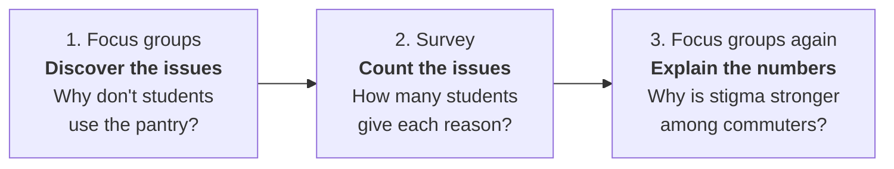
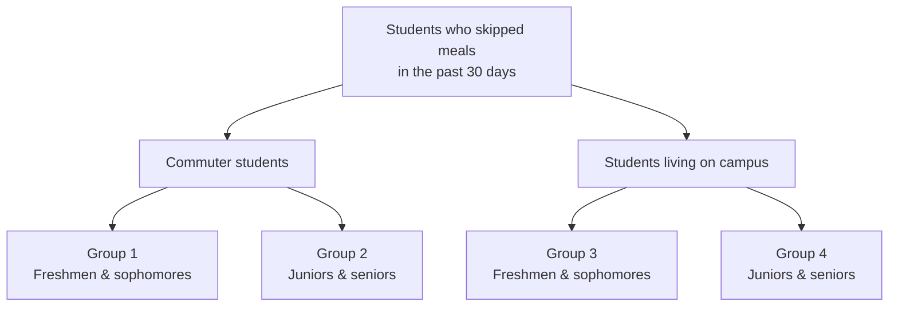
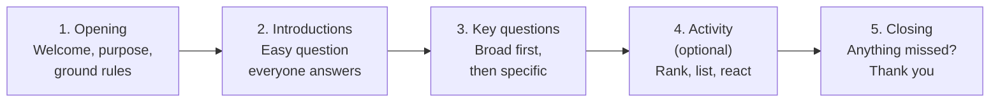

# Module items  { data-search-exclude }
## Assignment  { data-search-exclude data-readaloud-exclude }
- [Focus group interview :lucide-download:](https://docs.google.com/document/d/1VDKcJgV7qUDvVKiYwH_NnvYuf4Lu9qVo/edit?usp=sharing&ouid=100179871492576617561&rtpof=true&sd=true){ .md-button .md-button--primary target="_blank" rel="noopener" }
    - See: [[How to submit an assignment]]

### Sample assignment  { data-search-exclude data-readaloud-exclude }
- [Sample: Focus group interview :lucide-download:](https://docs.google.com/document/d/1CNIA0DzM1UAd5UC0wbEYS8yo01GQDnat/edit?ouid=100179871492576617561&rtpof=true&sd=true){ .md-button .md-button--primary target="_blank" rel="noopener" }

## Reading  { data-search-exclude data-readaloud-exclude }

:lucide-book-open:  
[Lune, Howard, and Bruce L. Berg. 2017. “Focus Group Interviewing.” Pp. 94–106 in Qualitative research methods for the social sciences. Harlow: Pearson.](https://drive.google.com/open?id=1IbIBv-Z_gS98ZBrnBF2OIWn8gyHBLVmY&usp=drive_fs){target="_blank" rel="noopener"}

<!-- slide-break -->
## Learning outcomes { data-search-exclude }
1. Define a focus group and explain how it differs from an individual interview
2. Identify when focus groups are (and are not) the right method
3. Plan a focus group study
    1. Number of groups,
    2. Size of groups, and
    3. Selecting participants
4. Explain the moderator's role and the level of moderator involvement
5. Analyze group interaction in focus groups
6. List the limitations and ethical challenges of focus groups

<!-- slide-break -->
# What is a focus group?
- !!! quote "Discussion"
    - A campus survey of 400 students finds that 38% skipped a meal in the past 30 days because there was not enough money for food.
    - The same survey finds that only 6% of students used the campus food pantry.
    - The survey tells you **how many**. It does not tell you **why** students who need food do not use the pantry.
    - How would you find out?
        - ??? tip "Show a sample answer"
            - *I would invite 6 or 7 students who skipped meals to sit together for an hour and talk about the pantry.*
            - *I would ask a few broad questions, like 'What do students say about the pantry?', and then mostly listen.*
            - *If one student says 'I didn't know it existed' and another says 'I knew, but I'd feel embarrassed walking in', the group starts comparing reasons. That comparison is exactly what I want to hear.*
                - *This is a focus group.*

<!-- slide-break -->
- A **[[focus group]]** is a group interview in which:
    - There are several participants (usually 5–10) plus a **[[moderator]]** who leads the discussion.
    - The questions focus on **one specific topic**.
    - The emphasis is on **interaction**: how participants respond to each other and build meaning together.
- Participants do not just answer the moderator. They explain themselves to each other, agree, disagree, and revise their views.
    - The essence of the data is the exchanges among participants
- A focus group is **not** a quick way to interview seven people at once.
    - The unit of analysis is the **group**, not the individual.
        - Five focus groups with 30 participants = 5 cases, not 30.

<!-- slide-break -->
## [[Focus group]] vs. [[in-depth interview]]
- | Feature | In-depth interview | Focus group |
  | :--- | :--- | :--- |
  | **Who talks** | One participant and the interviewer | 5–10 participants, guided by a moderator |
  | **What the data show** | One person's story, in depth | How a group talks about, debates, and makes sense of a topic |
  | **Researcher control** | High | Lower: participants steer the discussion |
  | **Best for** | Personal experiences, life histories, sensitive details | Shared meanings, attitudes, reasons, and the language people use |
  | **Challenging answers** | Interviewers rarely challenge what a person says | Participants challenge each other, so people must justify their views |

<!-- slide-break -->
## Where focus groups fit in a research project
- [[Focus group]]s are a [[qualitative research]] method, but they work well **together with surveys**.
    - Focus groups can come **before** a [[survey]], to discover the issues and the words people use.
    - Focus groups can come **after** a survey, to explain surprising numbers.

- Focus groups can also **pilot** a questionnaire.
    - Ask the group to read your [[survey questions]] exactly as written.
        - Did everyone understand the question the same way?
        - Which words were confusing?
        - Which answer was missing from the [[response category|response categories]]?

<!-- slide-break -->
# Uses of focus groups
- **To learn why people hold their views:** participants probe each other's reasons, so you hear justifications, not just opinions.
- **To see how people collectively make sense of a topic:** in everyday life, we form opinions by talking with others. Focus groups mirror that process.
- **To discover issues the researcher did not think of:** because the moderator gives up some control, participants raise what *they* see as important.
- **To give participants more voice:** feminist researchers value focus groups because participants, not the researcher, direct much of the conversation.
    - !!! abstract "Example: New Coke (1985)"
        - Before launching New Coke, Coca-Cola ran taste tests: people liked the new formula.
        - The company also ran focus groups across the U.S. Participants were asked how they would feel if the **old Coke were taken off the shelves**.
            - They reacted angrily.
        - Coca-Cola ignored the focus groups and replaced the old formula anyway.
            - The launch became one of the biggest marketing failures in business history, and the old Coke came back within months.
        - The taste test measured **preference**. The focus groups revealed **meaning**: for many people, Coke was part of their identity, not just a drink.

<!-- slide-break -->
## When *not* to use focus groups
- | Situation | Why a focus group is a poor fit | Better option |
  | :--- | :--- | :--- |
  | You need to know **how many** people hold a view | Focus groups are small and not randomly selected | [[Survey]] with [[probability sampling]] |
  | Participants must reveal **intimate details** of their private lives | Others in the room will hear | [[In-depth interview]] |
  | Participants are in a **hierarchy** (supervisors and employees, instructors and students) | The less powerful will hold back | Separate groups, or individual interviews |
  | You want to study what people actually **do** | People only *talk about* behavior in a focus group | **[[Ethnographic research]]** |

<!-- slide-break -->
# Planning a focus group study
## How many groups?
- **More than one, but not too many.**
    - With one group, the results may be specific to that group.
    - Published studies often use about 10–15 groups. Student projects usually use fewer, and must justify the number.
- Stop when you reach **[[theoretical saturation]]**:
    - When you can predict what the next group will say, and new groups add little new information, you have enough groups.
- Use **[[stratifying criteria]]** if views likely differ by age, gender, class, residence, and so on.
    - Each extra category means more groups.
- More groups also means much more data.
    - !!! abstract "How much data?"
        - One study of women watching violence on TV ran 14 sessions and produced more than **1,400 pages** of transcripts (Schlesinger et al. 1992).

<!-- slide-break -->
## [[Size of focus groups]]
- Typical size: **6–10 participants**; for complex topics, **5–7** works better.
- **Over-recruit** by one or two people, because some will not show up.
- **Use smaller groups when:**
    - The topic is sensitive, controversial, or complex.
    - Participants are very involved in the topic and have a lot to say.
    - You want detailed personal accounts.
- **Use larger groups when:**
    - Participants have low involvement in the topic.
    - You want to hear many brief suggestions.
- Groups that are too large split into side conversations, let a few people dominate, and make voices hard to tell apart in the recording.

<!-- slide-break -->
## Selecting participants
- Participants usually share an **experience or characteristic** related to the topic.
    - For the pantry study: students who skipped meals in the past 30 days.
- Focus groups do not use representative samples. Researchers usually recruit through:
    - **[[Purposive sampling]]:** recruit people who have the relevant experience.
    - **[[Snowball sampling]]:** ask participants to invite others like them.
- Then **sort participants into groups** using stratifying criteria, so you can compare groups.

- Holding a characteristic **constant within** each group makes participants comfortable; varying it **across** groups lets you compare.
    - If commuters talk about pantry hours and residents talk about stigma, that difference is a finding.

<!-- slide-break -->
### Strangers or [[natural groups]]?
- | | Strangers | Natural groups (friends, co-workers, classmates) |
  | :--- | :--- | :--- |
  | **Advantage** | People explain assumptions that friends would take for granted | Discussion feels more natural; easier to recruit |
  | **Risk** | Slower to warm up | Existing status differences and habits carry into the session |
  | **Use when** | You want participants to spell out what is usually unsaid | You study how a real group talks (e.g., a team, a club) |
    - In either case, avoid putting people with **authority over each other** in the same group.

<!-- slide-break -->
# The [[moderator]]
- The moderator guides the discussion but does **not** take part in it.
    - No opinions, no agreeing or disagreeing with participants.
        - A good session is about **90% participants, 10% moderator**.
- Ideally, a second researcher sits in as an **observer**:
    - Takes notes on group dynamics (who interrupts, who goes silent, nods, raised voices), and
        - Helps identify voices during transcription.

<!-- slide-break -->
## Level of [[moderator involvement]]
- **Step in as little as possible:**
    - Ask a small number of general questions.
    - Give participants a "free rein" so they show you what *they* think is important.
    - What looks like a digression may reveal something important to participants.
- **Intervene when:**
    - The discussion has gone completely off topic.
    - There is a long silence.
    - Someone makes an important point that the others do not pick up.
        - *"You said it was 'weird' to walk in. What makes it weird?"*
    - People talk over each other, which makes the recording impossible to transcribe.
- **Manage dominant and quiet participants** without embarrassing anyone:
    - *"That's one point of view. Does anyone see it differently?"*
    - *"We haven't heard from everyone yet. What do you think?"*
- Too much involvement turns the session into a series of individual interviews; too little lets the group drift away from the research question.

<!-- slide-break -->
## The [[moderator guide|moderator's guide]]
- The moderator's guide is the **plan for the session**: what to say, what to ask, and in what order.
- It usually has **fewer than a dozen** questions, written as [[open-ended questions]].
- Sessions usually run **1 to 2 hours**. Do not overload the guide.
    - The more complex or emotional the topic, the fewer questions you can cover.

<!-- slide-break -->
### Asking questions
- **An open approach:** one or two broad questions, and the group does the rest.
    - Good when you know little about the topic.
- **A more structured approach:** a list of topics and specific questions.
    - Good when you already know a lot, when participants have low interest, or when groups must be compared.
- Most studies fall **in between**: a short topic list, plus room for unexpected issues.
- **Sensitive topics: start general, then get specific.**
    - Not: *"Have you used the food pantry?"*
    - Instead: *"What do students on campus say about the food pantry?"*
        - The broad question lets people talk about "other students" first, and many will move to their own experience without being put on the spot.
- !!! abstract "Example: A moderator's guide for the pantry study"
    - **Introduction:** *"Please tell us your first name and your favorite cheap meal."*
    - **Key questions:**
        1. *"What do students on campus say about the food pantry?"*
        2. *"How did you first hear about it, if at all?"*
        3. *"What would make it easier for a student to use it?"*
    - **Activity:** *"Here are six possible reasons students don't use the pantry. Which three matter most? Discuss as a group."*
    - **Closing:** *"Is there anything we didn't ask that we should have?"*

<!-- slide-break -->
### Beginning and finishing
- **Beginning**
    - Thank people for coming, introduce yourself and the project.
    - Explain the format and how long it will take.
    - Explain the recording and why it is needed.
    - Set ground rules: one person speaks at a time; everyone's view matters; no one has to agree.
    - Review [[informed consent]] and [[confidentiality]].
    - Collect basic demographic information; use first-name cards.
- **Finishing**
    - Thank participants.
    - Explain what will happen to the data.
    - Arrange any follow-up sessions.
- !!! tip "The extended focus group"
    - Give participants a **short questionnaire before** the discussion. If someone's view shifts during the discussion, that shift shows the influence of the group.

<!-- slide-break -->
## Recording and transcription
- Always record. Notes alone cannot keep up with several people.
- The data are not only **what** people say, but **who** says it, **how** they say it (words, slang, tone), and **how the view develops** as people respond to each other.
- Transcription is slow: one hour of focus group can take **up to 8 hours** to transcribe.
    - Voices are hard to tell apart, and people talk over each other. Use a high-quality microphone.
- Focus groups can also run **online**, live (video call) or over several days (discussion board).
    - Online groups are cheaper and reach people who are hard to bring together, but the moderator has less control.

<!-- slide-break -->
# Analyzing [[group interaction]]
- Group interaction is what makes focus groups different from individual interviews.
    - Yet many studies report focus group data **as if it were one-on-one interviews**, quoting individuals and ignoring the interaction.
- There are two main types of interaction:
    - **[[Complementary interaction]]:** participants build on each other's remarks, and a shared view emerges.
    - **[[Argumentative interaction]]:** participants challenge each other, and people must explain and sometimes revise their views.
- !!! quote "Example: Complementary interaction"
    - **Maria:** *I didn't even know we had a pantry until my second year.*
    - **Jordan:** *Same. And when I found out, it was only open while I was in class.*
    - **Alex:** *I knew about it. I just felt weird walking in. Everyone can see you.*
    - **Maria:** *Yeah, honestly, I think that's the real reason. Not the hours.*
        - Each person adds to the previous remark. The group moves from "information" to "stigma" as the main reason.
- !!! quote "Example: Argumentative interaction"
    - **Sam:** *I don't think it's embarrassing. It's for students. Our fees pay for it.*
    - **Alex:** *That's easy to say if you've never needed it.*
    - **Sam:** *Fair. But if more people talked about it like it's normal, it wouldn't be weird.*
        - The disagreement forces both to explain their reasons, and Sam suggests a solution the researcher had not thought of.

<!-- slide-break -->
## Consensus, dissensus, and resonance
- When analyzing focus group transcripts, look for three patterns:
    - | Pattern | What to look for | Pantry example |
      | :--- | :--- | :--- |
      | **Consensus** | Ideas that go unchallenged and recur across speakers | "Most students don't know the pantry exists." |
      | **Dissensus** | Points where the group cannot agree, and *why* they disagree | Is using the pantry embarrassing or a right? |
      | **Resonance** | A remark that suddenly "catches fire" and unites the group | "Everyone can see you walk in." |
- Also note **intensity** (polite, tense, angry) and **silence**: when and why did someone stop talking?
- Compare patterns **within** each group and **across** groups.
    - Do commuters and residents give different reasons?

<!-- slide-break -->
# Limitations of focus groups
- **Less control** for the researcher: the group can take over the session.
- **Data are difficult to analyze:**
    - Large volume of data.
    - You need to analyze both *what* people say and *how they interact*.
- **Difficult to organize:** getting 7 people to the same room at the same time; no-shows are common.
- **Time-consuming to transcribe**, and people talk over each other.
- **Group effects:**
    - **[[Groupthink]]:** people go along with the emerging consensus instead of saying what they think.
        - Focus groups tend to produce more agreement than disagreement.
    - Dominant participants can silence quieter ones.
    - People may give **socially expected** answers in front of peers (similar to [[social desirability bias]]).
        - Boys talked about girls in a "macho" way in groups, but more sensitively in individual interviews (Morgan 2002). The gap between public and private views can itself be a finding.
- **Not generalizable:** small, non-random groups cannot tell you how common a view is.

<!-- slide-break -->
## [[Ethical research]] in focus groups
- Focus groups raise the same ethical issues as any study, plus one more: **other participants hear everything**.
- **[[Informed consent]]:** tell participants in advance what topics will be discussed. Sensitive topics should never be a surprise.
- **[[Voluntary participation]]:** remind participants they can stop or leave at any time.
- **[[Confidentiality]]:** the researcher can promise confidentiality, but **cannot guarantee that other participants will keep it**.
    - Say this openly at the start.
    - Ask every participant to sign a **group confidentiality agreement**: *"I agree to keep what others say in this session confidential."*
        - The agreement is a matter of honor, not law, but it makes everyone think about confidentiality, and gives anyone uncomfortable a chance to withdraw.
- **Group composition can create harm.**
    - Do not combine people in ways that make the session threatening, such as people who experienced discrimination with people who defend it.
    - Disagreement is fine; hostility and humiliation are not.
- !!! quote "Discussion"
    - You want to run a focus group on alcohol use among first-year students living in the same residence hall.
    - What ethical risks do you see, and how would you reduce them?
        - ??? tip "Show a sample answer"
            - *Students in the same hall know each other, so what someone says could spread around the building or reach an RA. Underage drinking could also create legal or housing problems.*
            - *I would name the topic in the consent form, ask everyone to sign a group confidentiality agreement, and remind them they can leave at any time.*
            - *I would ask general questions ('What is drinking culture like for first-years?'), not invite RAs, and use pseudonyms in the transcript.*
                - *If students need to describe their own drinking in detail, individual interviews would be safer.*
